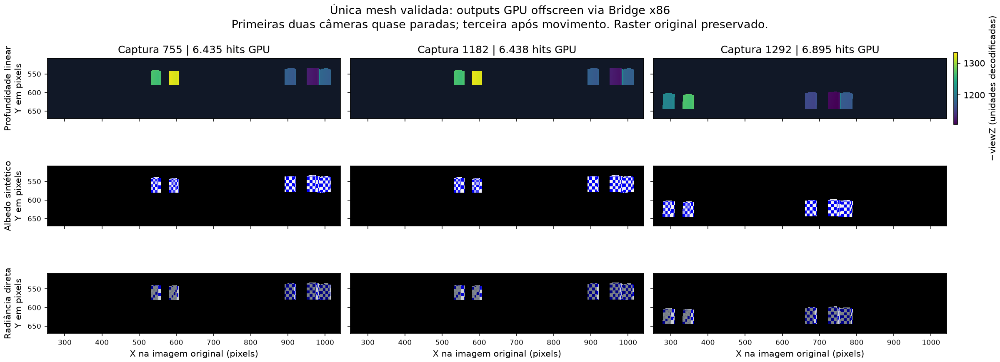

# EDF: validação no jogo e experimento de path tracing isolado

A execução real confirmou que a mesh permitida de **252 vértices / 144 triângulos** chega ao pipeline RTX. As rejeições observadas não demonstram um defeito nas matrizes: a câmera exige atualização no frame atual, e o Runtime impede uma segunda injeção no mesmo frame. A instrumentação antiga não permite provar a causa exata de cada rejeição.

Esta etapa mantém essas proteções e acrescenta um experimento **fora da imagem do jogo**, limitado à mesma mesh. Ele reutiliza o renderer existente, exporta resultados após confirmação de conclusão GPU e compara o backbuffer e os três MRTs originais antes/depois. **A substituição visual continua bloqueada.**

## Evidência real e milestones

O snapshot completo do log recebido é [actual_edf_runtime.log](actual_edf_runtime.log), SHA256 `ab56ea7ccf54b38f960814862e1489ea9cddad43a3151ec04cc13dbad032ad5f`, 67.921 bytes e 600 linhas. A auditoria reproduzível está em [actual_edf_log_audit.json](actual_edf_log_audit.json); os detalhes de cada evento estão em [ACTUAL_GAME_AUDIT.md](ACTUAL_GAME_AUDIT.md).

O log identifica `EDF-IA.exe`, confirma o fingerprint do executável e registra `rasterOnly=True`. Há 13 mensagens de reconhecimento, 13 câmeras Main aceitas, 6 gravações BLAS, 13 reutilizações BLAS e 13 inclusões na TLAS opaca. Essas contagens representam **amostras emitidas**, não toda a atividade: o logger limita cada estágio aos primeiros oito frames únicos e, depois, a intervalos mínimos de 120 frames.

As cadeias completas de criação aparecem nos frames **534, 694, 961, 1205 e 1371**. Todas as amostras usam o mesmo hash de geometria `0x32aeb7bb7e772c13`, posições `0x6d7756d3182eed1d`, índices `0xdb9f5782ee579d47` e UV `0x78eb56661f89659b`. O material/textura real permanece `0x2d5d4d9853fd5eac`; ele difere da textura sintética do replay. O erro máximo registrado pelo decoder é **0,0000978515 pixel**.

| Milestone | Evidência efetiva |
|---|---|
| M1 — carregar junto ao jogo | Demonstrado durante gameplay no intervalo registrado. O log recebido não contém confirmação explícita do encerramento do processo. |
| M2 — detectar draws | Demonstrado para a única candidata permitida. |
| M3 — reconstruir geometria estática | Mesh decodificada aceita em SceneManager/InstanceManager, comandos BLAS registrados e instance incluída na TLAS. Exibição reconstruída ainda não demonstrada no jogo. |
| M4 — câmera e transforms | Aceitação Main repetida e reprojeção matemática estável. Falta comparar a câmera GPU e sua projeção visual no novo experimento real. |
| M5 — texturas/materiais | Textura real vinculada e hash estável. Aparência path traced e interpretação material ainda não demonstradas. |
| M6 — replacements | Não exercitado. |
| M7 — path tracing estático | Não demonstrado pelo log recebido: `path_tracing_dispatched=0` em todas as mensagens `scene_only_frame`. |
| M8–M10 | Fora do escopo desta mesh estática. |

`blas_recorded` e `tlas_recorded` documentam gravação de comandos Vulkan. O log antigo não contém um readback sincronizado que confirme as interseções GPU. Essa distinção é o motivo do novo experimento.

## Câmera e ciclo dos frames

[CAMERA_LIFECYCLE.md](CAMERA_LIFECYCLE.md) contém o rastreamento completo do código. O frame usado na fila CS é `DxvkDevice::getCurrentFrameId()`, baseado em `QueuePresentCount`. Ele avança na apresentação efetiva pelo device, e não em cada tentativa de `Present` do lado D3D9.

O commit da draw chama `CameraManager::processCameraData`, que atualiza `RtCamera`. `RtCamera::isValid(frame)` exige exatamente `lastUpdateFrame == frame`. Uma instance ou BLAS em cache não atualiza a câmera. Como o perfil interpreta somente a candidata, um frame sem commit dessa mesh pode terminar sem uma câmera atual.

As rejeições `main_camera_invalid` do jogo estão nos frames **656, 799, 1108, 1215, 1266 e 1385**. Nenhum tem uma câmera aceita emitida no mesmo frame. Entretanto, o limitador antigo pode omitir essas mensagens; essa ausência não prova que a mesh desapareceu nem determina se uma tentativa aconteceu antes do commit. Permanecem possíveis eliminação pelo jogo, rejeição por um guard da candidata ou ordem de tentativa/commit. Não foi feita uma alteração na validade para encobrir essa incerteza.

A nova mensagem `stage=injection_snapshot` registra, na mesma fila:

- frame e serial da tentativa, origem (`present_fallback` ou outro ponto de chamada) e último frame injetado;
- último frame da draw permitida e quantidade de commits permitidos neste frame;
- último frame atualizado da câmera Main, sua validade e diferença entre a câmera decodificada e os shader constants;
- identidades de sessão, formato, dimensões e hash do target da tentativa e do MRT de origem.

Ela emite mudanças de estado e todas as tentativas enquanto há um pedido ativo. Isso permite distinguir `current_frame_draw_count=0 / camera_valid=0` de uma falha em um frame com draw e câmera atuais.

O replay de lifecycle envia seis frames, omite somente a candidata no frame **3**, conserva o controle negativo e a reencontra no frame **4**. O verificador exige ausência de câmera atual no frame 3, último update no frame 2 e recuperação atual no frame 4. Uma saída GPU com câmera antiga não passa.

## Duplicação da injeção

A única ocorrência recebida é `already_injected_this_frame` no frame **795**. Ela significa que o Runtime já marcou uma injeção nesse mesmo `QueuePresentCount`. O guarda precede a repetição da preparação da cena e do renderer.

No frame 795 também existem `scene_geometry` e `instance_accepted`. O log antigo não informa o target ou a origem da primeira tentativa. A ocorrência antecede uma pausa e recriação da swapchain; o código chama `EndFrame` antes de verificar a disponibilidade da swapchain, portanto pode haver tentativas de apresentação sem avanço do contador. A causalidade dessa ocorrência permanece sem comprovação.

Uma segunda tentativa bloqueada é comportamento normal. Uma primeira tentativa no ponto errado seria um problema separado, a ser demonstrado pelos snapshots. **O guarda de duplicação foi preservado.**

## Composição e correção restrita

A candidata é rasterizada originalmente em três MRTs fora da tela. A injeção de fallback recebe o backbuffer na apresentação, depois dos passes do EDF. O caminho genérico do Remix produz a imagem RTX e faz um `blitImageHelper` da imagem inteira para o target do jogo. Uma cena RTX com uma única mesh não representa o restante do EDF; copiar esse resultado apagaria seus demais passes.

Foi fechado somente esse caminho de configuração indevido: `D3D9Rtx::prepareEdfStaticDraw` agora define `compatibilityRasterOnly=true` para a candidata mesmo se o valor legado `rtx.edfStatic.rasterOnly` for configurado como `False`. Nesse caso, o Runtime avisa que o valor foi ignorado. O opt-in do novo experimento é independente desse campo.

O reconhecimento, os hashes e a whitelist não foram ampliados. Outras draws preservam o raster. Não foram mudadas as regras genéricas de câmera, os guards de duplicação ou o comportamento de outros jogos.

## Arquitetura do experimento fora da tela

`EdfStaticProbe` é criado somente quando a draw com o marker EDF validado chega a `RtxContext::commitGeometryToRT`. A opção `rtx.edfStatic.probe.enabled` é desligada por padrão. No perfil do experimento, **F9** arma um frame; **F8** cancela pedidos pendentes. A quantidade é limitada a 1..3 frames, sem repetir automaticamente durante gameplay. Pedidos em andamento impedem um novo armamento. Um pedido sem frame compatível expira após 300 frames.

Antes de executar, `beginFrame` exige:

- exatamente um commit permitido no frame e uma única instance ordenada, visível, com máscara não nula e marker EDF;
- 252 vértices / 432 índices tanto na geometria original quanto na modificada, e hash modificado igual ao original;
- câmera Main atual, matrizes dos shader constants iguais à interpretação comprovada dentro de `0,0001` e jitter zero;
- targets originais válidos, sem multisampling, com formatos RGBA/BGRA8 compatíveis e dimensões iguais; limite de 4.194.304 pixels.

O estágio `whitelist_accepted` é emitido em cada frame do experimento, sem depender do limitador antigo. Ele identifica o hash da mesh, o par de shaders, a instance e as contagens. Os dados correspondentes também entram no JSON.

Depois de `prepareSceneData`, o experimento percorre o renderer existente: argumentos de rays, path tracing, demodulação, composição interna e pós-processamento. O resultado fica nos recursos RTX. **A composição interna do renderer não é uma composição sobre o EDF.** No modo do experimento, a geração de frames e o blit final para o jogo são evitados; `queueReadback` ocupa esse ponto.

A iluminação é uma luz de fallback controlada. Não recupera a iluminação do pixel shader do EDF. A textura é real quando o teste roda dentro do jogo; os replays usam a textura sintética da fixture, portanto seus resultados não comprovam a aparência original.

## Confirmação GPU e preservação dos passes

São exportados quatro resultados GPU: `linear_z` R32F, albedo A2B10G10R10, radiância difusa direta RGBA16F e resultado final fora da tela RGBA16F. O callback de `sync::CallbackFence` grava os arquivos depois das cópias e da barreira de transferência para leitura pelo host. `gpuCompleted=true` decorre desse callback, não apenas do registro de dispatch.

O experimento também copia **antes e depois** o target da injeção e os três MRTs originais, deduplicando somente imagens idênticas. A comparação é `memcmp` de todos os bytes; os raws são preservados e recebem FNV1a64. O JSON registra as identidades dos targets, o resultado individual e `originalTargetsUnchanged`.

O verificador [verify_probe.py](../../../runtime/tools/edf_static_gpu_replay/verify_probe.py) recalcula FNV1a64 e SHA256, compara os bytes originais, correlaciona a whitelist e os eventos com o frame/request, confere tamanho/formato de cada imagem e exige câmera atual. Ele testa a álgebra das matrizes e a igualdade entre as matrizes decodificadas e **a câmera efetivamente copiada para `RaytraceArgs`**.

A referência CPU independente lê o SHORT4 medido, aplica a escala comprovada `0,25`, valida o OBJ contra esses vértices e os índices originais UINT16 rebased. Os raios usam o centro de cada pixel e a convenção do `camera.slangh`: NDC `(2u-1, 1-2v)`, transformação pela inversa da projeção e pela rotação view-to-world. Não há tentativa automática de escolher um Y flip para melhorar a coincidência.

A comparação exige silhueta compatível com no máximo um pixel de tolerância de borda, IoU mínimo de 0,98 e profundidade dos pontos interiores compatível com as interseções mais próximas. A referência usa as componentes fechadas da candidata, sem generalizar a semântica de culling para outras meshes. Se a câmera exigir clipping da referência, o verificador rejeita o caso em vez de inventar esse resultado.

Essas comparações cobrem **quatro targets de cor** durante o experimento: backbuffer e três MRTs. O depth/stencil original do EDF não recebeu readback antes/depois nesta etapa; sua preservação não está comprovada por comparação binária. A comparação de pixels do replay desligado/ligado testa também a preservação da imagem raster no fluxo posterior. Nenhuma dessas verificações prova um futuro ponto de substituição parcial dos MRTs: **o ponto de composição visual ainda não foi validado**.

## Compilação e testes desta revisão

Runtime do teste anterior no EDF: SHA256 `7b8ab28eee0838ee2e9e018663e7f911df6d311d7b25437587fb5cffc7cdb98d`. Novo Runtime compilado: SHA256 `93b265b00cb55b51b25c5b7f0495d72a9e0cf76d55abe1462f932501843b4641`. Atualização de 8 de outubro de 2026: o usuário executou esse Runtime no EDF; as três capturas GPU reais e seus PNGs foram validados no [relatório de visualização](<D:/EDF IA RTX REMIX/analysis/edf/visualization/REPORT.md>).

A integridade final está em [delivery_verification.json](delivery_verification.json): DLL de **188.414.464 bytes**, mesmo hash nos pacotes x64 e x86 via Bridge, com **187 / 189 arquivos** conferidos respectivamente. Os quatro casos nativos com probe executam seis frames e **1.303 verificações HRESULT bem-sucedidas por caso** (5.212 no total). Há 12 frames com readbacks GPU concluídos: seis do controle escuro e seis com a luz corrigida. Os casos de ausência/recuperação de câmera e a rejeição da draw com vértice alterado também estão registrados.

Os **30 testes sintéticos do verificador passaram**: [probe_verifier_unit_tests.json](probe_verifier_unit_tests.json). Incluem evidência GPU incompleta, matriz transposta, câmera antiga, troca de shader/mesh, request incorreto, raw truncado, checksum inválido, pixels originais alterados e orientação Y incorreta. Esses resultados são explicitamente marcados como `fixtureOnly` / `notGpuEvidence` e não substituem testes GPU.

O primeiro replay positivo foi rejeitado corretamente pelo guard de jitter. A configuração explícita `upscalerType=0` era posteriormente substituída pelo preset derivado do DLSS. A evidência dessa tentativa está em [jitter_guard_rejected/remix-dxvk.log](jitter_guard_rejected/remix-dxvk.log), com a configuração arquivada ao lado. A correção é restrita ao perfil do experimento: preset DLSS desligado, preset gráfico Custom e preservação de resolução nativa. O guard continua exigindo jitter zero; as matrizes não foram alteradas para esconder a diferença.

### Resultado dos replays nativos

Os replays **x64 e x86 via Bridge passaram na GPU**: [x64_probe_verification.json](x64_probe_verification.json) e [x86_probe_verification.json](x86_probe_verification.json). Os três frames de cada execução têm callback de conclusão, matrizes efetivamente usadas iguais à câmera decodificada, jitter zero e quatro targets originais integralmente iguais antes/depois. A comparação com o replay sem probe também passou: [x64_raster_preservation.json](x64_raster_preservation.json) e [x86_raster_preservation.json](x86_raster_preservation.json), com os três BMPs raster originais byte a byte iguais e não uniformes.

| Frame do replay / captura original | Hits GPU / CPU | IoU da silhueta | Erro máximo de profundidade interior |
|---|---:|---:|---:|
| 0 / 755 | 6.435 / 6.452 | 0,997365 | 0,000348224 |
| 1 / 1182 | 6.438 / 6.449 | 0,998294 | 0,000397924 |
| 2 / 1292 | 6.895 / 6.924 | 0,995812 | 0,000366449 |

As bounding boxes da máscara de hits GPU e CPU são idênticas nos três frames. As diferenças da máscara ficam dentro da tolerância de um pixel na borda. No frame 3, sem a candidata, a câmera tem último update no frame 2 e é inválida; no frame 4, a candidata e a câmera atual retornam. O verificador confirma esse comportamento esperado sem reutilizar uma câmera antiga.

O primeiro resultado exportou radiância difusa direta zerada nas duas arquiteturas. Essa evidência foi preservada nos arquivos acima. A análise das faces visíveis e normais decodificadas mostrou que a direção inicial da luz diagnóstica, `(-0,2, -1, 0,4)`, incidia no lado oposto às faces observadas: o produto `N · (-direction)` era negativo. Essa interpretação CPU não equivale a um readback de normais de shading da GPU; foi testada com uma comparação A/B.

**O teste A/B resolveu a ausência de iluminação alterando somente o perfil**, com direção oposta `(0,2, 1, -0,4)`. Nenhum shader, decoder ou código do renderer foi alterado entre as duas execuções. As execuções iluminadas **x64 e x86 via Bridge passaram** em [x64_lit_verification.json](x64_lit_verification.json) e [x86_lit_verification.json](x86_lit_verification.json), com as mesmas silhuetas/profundidades da tabela, mesmos guards e os quatro targets originais preservados. A comparação raster também passou nos dois casos: [x64_lit_raster_preservation.json](x64_lit_raster_preservation.json) e [x86_lit_raster_preservation.json](x86_lit_raster_preservation.json).

Agora há radiância difusa positiva em **6.435 / 6.438 / 6.895 pixels** por arquitetura, respectivamente: todas as amostras de hits GPU dos três frames. Não há valores não finitos. Isso comprova interseções e iluminação direta pelo caminho RTX existente para a candidata, sob uma luz controlada. O diagnóstico matemático e o controle A/B estão detalhados em [ILLUMINATION_VALIDATION.md](ILLUMINATION_VALIDATION.md).

Não se usou o resultado final pós-processado como prova isolada de iluminação: a confirmação vem do buffer de radiância e da comparação A/B com geometria, câmera e código iguais. A luz de fallback é diagnóstica; não é a iluminação original do EDF. Os replays ainda usam texturas sintéticas e não provam os materiais originais.

A figura mostra readbacks do **replay nativo via Bridge x86 com texturas sintéticas**, usando os dados geométricos e as câmeras das capturas reais. Ela não é uma imagem do EDF com substituição visual. A comparação usa a posição original dos pixels; a terceira coluna mostra o movimento relativo comprovado da câmera.

As mensagens de erro no encerramento da build de debug indicam `43` objetos comuns não descartados também no raster baseline. Elas estão preservadas no pacote de evidência; os HRESULT e readbacks passaram. Essa observação existente não foi tratada como uma causa das rejeições de câmera nem corrigida com alterações fora do escopo.

**Atualização de 8 de outubro de 2026: o teste offscreen do novo Runtime dentro do EDF passou em três capturas reais**, com conclusão GPU, radiância não nula e quatro targets de cor inalterados. Essa evidência está no [relatório atual](<D:/EDF IA RTX REMIX/analysis/edf/visualization/REPORT.md>). Substituição visual e PT contínuo no jogo ainda não estão demonstrados. [next_validation/validation.json](<D:/EDF IA RTX REMIX/analysis/edf/next_validation/validation.json>) mantém separadas as evidências históricas dos replays e a sessão real. Uma falha em qualquer guard bloqueia a progressão para substituição visual.

## Revisão de escopo

A leitura independente de `RtxContext::injectRTX`, `commitGeometryToRT`, `EdfStaticProbe::beginFrame` e do perfil não encontrou um bloqueio comprovado que exija outra mudança de código. O probe só é criado pelo marker da draw validada; esse marker vem do decoder condicionado ao executável/fingerprint. O fluxo normal de outros jogos não arma o probe. Draws fora da whitelist no perfil EDF preservam o raster. A execução fora da tela exige câmera atual e cena restrita; sua saída não passa pelo blit final do jogo. As proteções de câmera e duplicação continuam intactas.

## Fontes principais

| Arquivo / função | Responsabilidade |
|---|---|
| `src/d3d9/d3d9_rtx.cpp`: `internalPrepareDraw`, `prepareEdfStaticDraw`, `EndFrame` | Whitelist, preservação obrigatória da draw e apresentação do perfil restrito. |
| `src/dxvk/dxvk_device.cpp`: `getCurrentFrameId`, `presentImage`, `incrementPresentCount` | Contador de frame da fila. |
| `src/dxvk/rtx_render/rtx_camera_manager.cpp`: `processCameraData` | Classificação e atualização Main. |
| `src/dxvk/rtx_render/rtx_camera.cpp`: `update`, `getShaderConstants`; `rtx_camera.h`: `isValid` | Validade por frame e matrizes GPU. |
| `src/dxvk/rtx_render/rtx_context.cpp`: `commitGeometryToRT`, `injectRTX`, `endFrame`, `updateRaytraceArgsConstantBuffer` | Correlação dos commits, snapshots e integração controlada com o renderer. |
| `src/dxvk/rtx_render/rtx_edf_static_probe.cpp`: `noteDraw`, `recordInjection`, `beginFrame`, `queueReadback`, `writeReadback` | Contadores, guards, cópias de targets e confirmação por fence. |
| `src/dxvk/rtx_render/rtx_edf_static_probe.h`: opções e estado `EdfStaticProbe` | Armamento/cancelamento e limites do pedido. |
| `src/dxvk/shaders/rtx/concept/camera/camera.slangh`, `concept/ray/ray.slangh` | Convenção de raios usada na referência independente. |
| `src/dxvk/rtx_render/rtx_options.cpp`: `updateUpscalerFromDlssPreset` | Aplicação do preset que precisa ser desligado no perfil diagnóstico. |

Os arquivos são relativos ao checkout `D:\EDF IA RTX REMIX\runtime`. O teste dentro do EDF deve seguir as instruções entregues com o novo perfil. Após o teste, são necessários o log completo, o JSON/raws da sessão F9 e, se houver rejeição, a janela F10 correspondente. O protocolo de recuperação permite cancelar pelo F8, desligar somente o probe e restaurar a instalação anterior com o deployment existente.
